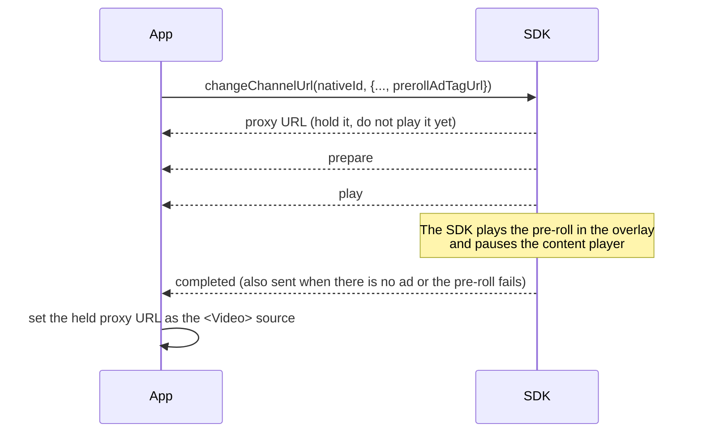

# Linear TV Ad Implementation

Linear TV and FAST channels use `changeChannelUrl()`. The SDK returns a local proxy URL that carries the original stream with replacement ads spliced into the manifest, and the breaks play themselves — scheduled by the cue in the stream, with no `play()` call from your app.

Read [How the Integration Works](../how-the-integration-works.md) first: the two-phase handover below is the core of it.

## Implementation

```tsx
import React, {useCallback, useEffect, useRef, useState} from 'react';
import {StyleSheet, View} from 'react-native';
import Video from 'react-native-video';
import {
  addAdEventListenerFor,
  changeChannelUrl,
  release,
  stop,
} from '@anypoint/flower-sdk-react-native';

// A cheap cap, so a channel that fails every time does not restart forever.
const MAX_RESTARTS = 3;

type Props = {
  nativeId: string;
  videoUrl: string;
  adTagUrl: string;
  channelId: string;
};

export function ChannelPlayer({nativeId, videoUrl, adTagUrl, channelId}: Props) {
  // Phase 1: mount on the ORIGINAL url so react-native-video builds its player.
  const [sourceUri, setSourceUri] = useState(videoUrl);
  const handedOver = useRef(false);
  const restarting = useRef(false);
  const restarts = useRef(0);

  // Phase 2: hand the player over, then play the proxy url it returns. Used for the first
  // start and for every restart after an 'error'.
  const startChannel = useCallback(async () => {
    const proxyUrl = await changeChannelUrl(nativeId, {
      videoUrl,
      adTagUrl,
      channelId,
    });
    handedOver.current = true;
    // Phase 3: swap the source. The player is reused, not rebuilt. Every call returns a new
    // proxy url, so a restart always reloads the player.
    setSourceUri(proxyUrl);
  }, [nativeId, videoUrl, adTagUrl, channelId]);

  // The first start, once the player exists.
  const handOver = useCallback(async () => {
    if (handedOver.current) {
      return;
    }
    try {
      await startChannel();
    } catch (error: any) {
      console.error(`changeChannelUrl failed: ${error.message}`);
    }
  }, [startChannel]);

  // On 'error': stop the ads manager, then start the channel over exactly as the first time.
  const restartChannel = useCallback(async () => {
    if (restarting.current || restarts.current >= MAX_RESTARTS) {
      return;
    }
    restarting.current = true;
    restarts.current += 1;
    try {
      await stop(nativeId);
      await startChannel();
    } catch (error: any) {
      console.error(`channel restart failed: ${error.message}`);
    } finally {
      restarting.current = false;
    }
  }, [nativeId, startChannel]);

  // Ad events for this channel only.
  useEffect(() => {
    const subscription = addAdEventListenerFor(nativeId, event => {
      switch (event.event) {
        case 'adBreakPrepare':
          console.log(`ad break loaded: ${event.adCount} ads`);
          break;
        case 'play':
          console.log('ad break started');
          break;
        case 'completed':
          // Also arrives for a break that stop() cut short, so keep this idempotent.
          console.log('ad break finished');
          break;
        case 'error':
          console.error(`ad error: ${event.message}`);
          restartChannel();
          break;
      }
    });
    return () => subscription.remove();
  }, [nativeId, restartChannel]);

  // The native side retains this channel's ad overlay, so it has to be told when the video goes.
  useEffect(
    () => () => {
      if (handedOver.current) {
        release(nativeId).catch(() => {});
      }
    },
    [nativeId],
  );

  return (
    <View style={styles.player}>
      <Video
        // The SDK addresses this player by nativeID. It must be unique on screen.
        nativeID={nativeId}
        source={{uri: sourceUri}}
        style={StyleSheet.absoluteFill}
        resizeMode="contain"
        // onLoad is the reliable signal that the player exists.
        onLoad={handOver}
        onError={e => console.error(`player error: ${JSON.stringify(e)}`)}
      />
    </View>
  );
}

const styles = StyleSheet.create({
  player: {width: '100%', aspectRatio: 16 / 9, backgroundColor: '#000'},
});
```

:::caution
`handOver` is guarded with a ref because `onLoad` fires again after the source is swapped to the proxy URL. Without the guard the second `onLoad` would call `changeChannelUrl()` a second time.
:::

## Recovering from an Error

An `error` event on a channel means the SDK could not keep its ads in the stream — for one, a playlist it failed to manipulate, which can leave the player sitting on a broken stream. It is also sent, once per incident, when the stream itself stops and the native SDK will not recover it; its message then starts with `playback unrecoverable` (not reported on iOS with `playerType: 'bitmovin'`). Recover by starting the channel over, which is what `restartChannel` above does:

1. `await stop(nativeId)` stops the channel's ads manager. Unlike `release()`, it keeps the ad overlay and the event subscription in place, so the restart reuses them.
2. Call `changeChannelUrl(nativeId, ...)` again with exactly the same parameters as the first time, `prerollAdTagUrl` included. It returns a **new** proxy URL.
3. Set that URL as the `<Video>` source, the same way as on the first start. The player is reused, not rebuilt; `onLoad` fires again, and the `handedOver` guard keeps it from starting a second handover.

`stop()` also ends any break in progress, and that break can still report `completed` — after the `error`, and even after `stop()` has resolved. Keep the `completed` branch idempotent (clear ad UI state, nothing more) so it cannot disturb the restart. `MAX_RESTARTS` is a cheap cap that keeps a channel failing on every start from restarting in a loop; reset the counter in whatever way suits your app, such as on a channel change.

:::note
A [channel pre-roll](#pre-roll-ads) needs none of this. A pre-roll that fails ends with `completed`, not `error`: the SDK finishes it and resumes the channel itself, so the `completed` handling below already covers it. A restart of a channel that was first started with `prerollAdTagUrl` does not show the viewer the pre-roll again, even though it passes `prerollAdTagUrl`: the SDK remembers the channel (`channelId`) entered last and skips the pre-roll when the same channel is entered again. It then sends `completed` right after `changeChannelUrl()` resolves, the same way as a pre-roll with no ad, so the restart holds the proxy URL until `completed` exactly like the first start.
:::

:::info
The SDK forgets that channel only when a VOD or inline ad is requested (`requestVodAd()`, `requestAd()`), not on `stop()` or `initialize()`. Channel A → B → A plays A's pre-roll again, because B was entered last. Entering the channel that was entered last again — a restart, or any other call for the same `channelId` — skips the pre-roll unless a VOD or inline ad was requested in between. The SDK keeps one such channel for the whole app, not one per `nativeId`.
:::

## Targeting and Headers

`changeChannelUrl()` accepts optional targeting information and HTTP headers:

```tsx
const proxyUrl = await changeChannelUrl(nativeId, {
  videoUrl,
  adTagUrl,
  channelId,
  // Additional information pre-agreed for targeting.
  extraParams: {title: 'My Summer Vacation', genre: 'horror'},
  // Headers added to ad requests.
  adTagHeaders: {'custom-ad-header': 'custom-ad-header-value'},
  // Headers added to requests for the original stream.
  channelStreamHeaders: {'custom-stream-header': 'custom-stream-header-value'},
});
```

See [Define extraParams](../define-extra-params.md) for the targeting keys, and [`changeChannelUrl`](../../api/linear-channels-fast.md) for the full parameter reference.

## Pre-roll Ads

A channel pre-roll is an ad break that plays when the viewer enters a channel, **before** the live stream itself is shown. It is separate from the breaks spliced into the stream: the SDK requests it from its own ad tag, plays it on its own ad player in the overlay, and only then lets the channel play. Enable it by passing `prerollAdTagUrl` to `changeChannelUrl()`; without it the channel starts with no pre-roll.

### How It Works



1. `changeChannelUrl()` requests the pre-roll together with the channel and resolves with the proxy URL as usual. **Hold** that URL instead of setting it as the source.
2. The SDK starts the pre-roll itself: it sends `prepare` and `play`, and pauses the content player while the pre-roll is on screen. Your app calls nothing for it — not even `play()`.
3. When the pre-roll ends, the SDK sends `completed`. Set the held proxy URL as the `<Video>` source there. From then on the channel behaves exactly as without a pre-roll.

Keep the `<Video>` paused on the original URL until then (`paused` set while the pre-roll is pending, as in the [Linear TV prompt](../../prompts/by-case/linear-tv/react-native-video.md)), so the channel is not seen or heard before or under the pre-roll. `onLoad` still fires while paused, so the handover is unaffected.

**No ad or a failure.** When the pre-roll tag returns no ad, or the pre-roll request or playback fails, the SDK still finishes with `completed` — not `error` — so the held proxy URL is applied and the channel starts. A failed pre-roll needs no restart.

The example below holds the proxy URL and applies it from `completed`:

```tsx
const [sourceUri, setSourceUri] = useState(videoUrl);
const proxyUrlRef = useRef<string | null>(null);

useEffect(() => {
  const subscription = addAdEventListenerFor(nativeId, event => {
    if (event.event === 'completed' && proxyUrlRef.current) {
      // The pre-roll is over — now switch the content to the proxy url.
      setSourceUri(proxyUrlRef.current);
      proxyUrlRef.current = null;
    }
  });
  return () => subscription.remove();
}, [nativeId]);

// The same call for the first start (handOver) and for a restart after an 'error'.
const startChannel = useCallback(async () => {
  const proxyUrl = await changeChannelUrl(nativeId, {
    videoUrl,
    adTagUrl,
    channelId,
    prerollAdTagUrl,
  });
  // Held rather than applied — the pre-roll plays first. On a restart the SDK skips the
  // pre-roll of the channel entered last and sends completed right away.
  proxyUrlRef.current = proxyUrl;
}, [nativeId, videoUrl, adTagUrl, channelId, prerollAdTagUrl]);
```

The first start and `restartChannel` both call `startChannel()`; the restart calls it after `stop()`, keeping the restart cap from the [example above](#implementation).

### Channel Switch

Every `changeChannelUrl()` call starts a new session. The SDK first stops the current one — a pre-roll still playing included — and then requests the pre-roll of the channel in the new call. Switching to another channel with its own `prerollAdTagUrl` is therefore a first start again: hold the new proxy URL until `completed`. Omit `prerollAdTagUrl` to switch without a pre-roll, and play the new proxy URL right away. The one exception is the channel entered last: calling `changeChannelUrl()` again for it, as a restart after an `error` does, skips its pre-roll even with `prerollAdTagUrl`, and `completed` follows right away — see [Recovering from an Error](#recovering-from-an-error).

### PIP Mode

In the default mode (`setIgnoreAdBreakInPIPMode(true)`), a channel pre-roll is paused when the user leaves the app and resumed when the user comes back, in the same way as VOD ads, while ads spliced into the stream keep playing. This only works if the app reports both moments through `notifyUserLeftApp()`, whether or not it enters PIP. See [PIP Mode Support](../../getting-started/pip-mode-support.md).

### Bitmovin Player

With `playerType: 'bitmovin'` the pre-roll works the same way: hold the proxy URL and load it into the Bitmovin player from `completed`. See [Using the Bitmovin Player](../using-bitmovin-player.md#channel-pre-roll).

## Stopping the Break

`stop(nativeId)` stops the channel's ads manager. It ends any break in progress and ends the ad session as well: the SDK tears down its ad handling and shuts down the local proxy, so the proxy URL the `<Video>` is playing stops serving and no later break plays. The ad overlay and the event subscription stay in place. To keep watching the channel with ads, call `changeChannelUrl()` again and play the new proxy URL it returns.

```tsx
await stop(nativeId);
```

To leave the channel entirely, call `release(nativeId)` instead. After an `error`, `stop()` is the first half of a restart — see [Recovering from an Error](#recovering-from-an-error).

## Related

*   [`changeChannelUrl` API reference](../../api/linear-channels-fast.md)
*   [Ad Events](../../api/ad-event.md)
*   [Using the Bitmovin Player](../using-bitmovin-player.md)
