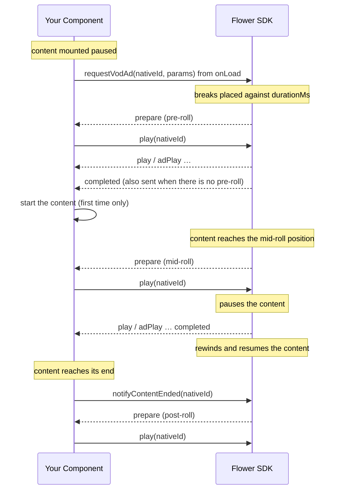

# VOD Ad Implementation

VOD ads are requested with `requestVodAd()`. Nothing is rewritten here — the content keeps playing from its own URL, and each break arrives as a `prepare` event, which is where the app calls `play()`.

Around the content itself, the app has exactly two jobs: **hold it before it first starts**, and **leave it alone after that** — apart from a safety-net resume when a mid-roll fails.

*   **Before the first start.** The SDK does not pause the content for a pre-roll. Mount the `<Video>` paused, request the ads from `onLoad`, and start the content on the first `completed` or `error`. The SDK sends `completed` even when there is no pre-roll, the ad response is empty or the request fails, so the content always gets started.
*   **After the content has started.** By default ([`setIgnoreAdBreakInPIPMode`](../../getting-started/pip-mode-support.md) `true`), a break plays on the SDK's own ad player, layered over your `<Video>`. For a mid-roll, the SDK pauses the content itself, and at `completed` (or `error`) seeks it back by the rewind duration (5 seconds) and resumes it. After a post-roll the content has ended, so it is not resumed. **Do not pause, seek or re-source the content once it has started.**
*   **On `error` after the content has started.** Log it. After a failed mid-roll the SDK has already brought the content back; do not stop, seek or re-source it, but resume it as a safety net (`videoRef.current?.resume()`, harmless if it is already playing). If the content has ended (a post-roll failed), there is nothing to resume. The exception is an `error` whose message starts with `playback unrecoverable` — the content itself stopped. See [Handling `error`](#handling-error).

## The Break Lifecycle



## Implementation

```tsx
import React, {useCallback, useEffect, useRef, useState} from 'react';
import {StyleSheet, View} from 'react-native';
import Video, {type VideoRef} from 'react-native-video';
import {
  addAdEventListenerFor,
  notifyContentEnded,
  play,
  release,
  requestVodAd,
} from '@anypoint/flower-sdk-react-native';

type Props = {
  nativeId: string;
  contentUrl: string;
  adTagUrl: string;
  contentId: string;
  durationMs: number;
};

export function VodPlayer({
  nativeId,
  contentUrl,
  adTagUrl,
  contentId,
  durationMs,
}: Props) {
  // The content is held until the pre-roll is over. Only ever goes from false to true.
  const [contentStarted, setContentStarted] = useState(false);
  // The same two facts, readable from the event listener without re-subscribing.
  const contentStartedRef = useRef(false);
  const contentEnded = useRef(false);
  const videoRef = useRef<VideoRef>(null);
  const requested = useRef(false);

  useEffect(() => {
    const startContent = () => {
      contentStartedRef.current = true;
      setContentStarted(true);
    };
    const subscription = addAdEventListenerFor(nativeId, event => {
      if (event.event === 'prepare') {
        // Only play the break. Once the content has started, the SDK pauses and resumes it.
        play(nativeId).catch(e => console.error(`play failed: ${e.message}`));
      } else if (event.event === 'completed') {
        // The first completed ends the pre-roll, or stands in for it when there is none.
        // Later ones change nothing: the content is already started.
        startContent();
      } else if (event.event === 'error') {
        console.error(`ad error: ${event.message}`);
        if (!contentStartedRef.current) {
          // Pre-roll failed: never leave the content held.
          // A completed may also arrive for the same break; startContent() is safe twice.
          startContent();
        } else if (event.message?.startsWith('playback unrecoverable')) {
          // The content itself stopped and the SDK will not recover it:
          // reload the content or show an error.
        } else if (!contentEnded.current) {
          // Mid-roll failed: the SDK has normally brought the content back already.
          // Resume as a safety net (harmless if already playing). No seek, no source change.
          videoRef.current?.resume();
        }
        // Post-roll failed: the content has ended, there is nothing to resume.
      }
    });
    return () => subscription.remove();
  }, [nativeId]);

  useEffect(
    () => () => {
      if (requested.current) {
        release(nativeId).catch(() => {});
      }
    },
    [nativeId],
  );

  // The player must exist before requesting, so this runs from onLoad.
  const request = useCallback(async () => {
    if (requested.current) {
      return;
    }
    try {
      await requestVodAd(nativeId, {adTagUrl, contentId, durationMs});
      requested.current = true;
    } catch (error: any) {
      console.error(`requestVodAd failed: ${error.message}`);
    }
  }, [nativeId, adTagUrl, contentId, durationMs]);

  return (
    <View style={styles.player}>
      <Video
        ref={videoRef}
        nativeID={nativeId}
        // The content url is never rewritten for VOD.
        source={{uri: contentUrl}}
        style={StyleSheet.absoluteFill}
        resizeMode="contain"
        // Held before the first start only. Never paused again from ad events.
        paused={!contentStarted}
        onLoad={request}
        // Without this the SDK never learns the content is over, and no post-roll can run.
        onEnd={() => {
          // Marked first, so a post-roll error does not resume the ended content.
          contentEnded.current = true;
          notifyContentEnded(nativeId).catch(e =>
            console.error(`notifyContentEnded failed: ${e.message}`),
          );
        }}
        onError={e => console.error(`player error: ${JSON.stringify(e)}`)}
      />
    </View>
  );
}

const styles = StyleSheet.create({
  player: {width: '100%', aspectRatio: 16 / 9, backgroundColor: '#000'},
});
```

:::caution
`requestVodAd()` needs the player to exist, exactly like `changeChannelUrl()` — call it after `onLoad`, not while mounting. Unlike the linear case there is no source swap afterwards, so `onLoad` fires only once and no re-entry guard would be strictly necessary; the ref above simply keeps the component safe against remounts.
:::

:::caution Hold the content before it starts — never after
The SDK does not hold the content for a pre-roll. Mounted without `paused`, the content plays underneath the pre-roll and both soundtracks are heard at once. Hold it, as above, until the first `completed` or `error`.

Once the content has started, do not drive the `paused` prop (or a Bitmovin player's `pause()`, `seek()` or `load()`) from `prepare`, `play`, `completed` or `error`. The SDK owns those moments: it pauses the content for a mid-roll and, at `completed`, rewinds and resumes it. This holds for `playerType: 'bitmovin'` on iOS too, where the SDK pauses and resumes the content through the Bitmovin player. The one exception is a failed mid-roll, where the app resumes the content as a safety net — see [below](#handling-error).

With `setIgnoreAdBreakInPIPMode(false)`, the break plays on the player the SDK took over from `<Video nativeID={nativeId}>`. A pause written around `play()` after the content has started can then land on the player the ad is now playing on, which freezes the ad, withholds `completed` and never hands the content back. See [PIP Mode Support](../../getting-started/pip-mode-support.md) for this mode.
:::

## Handling `error` {#handling-error}

For VOD, `error` arrives when:

*   **An ad fails to play** in a pre-, mid- or post-roll — its media cannot be decoded or cannot be reached.
*   **Content playback stops and the SDK cannot recover it.** The message starts with `playback unrecoverable`. Not reported on iOS with `playerType: 'bitmovin'`.
*   **On Android, an internal SDK error occurs.**

A VMAP/VAST request that fails or times out, or a break with no ads, is not an `error`: it ends with `completed` (with no ads, `adBreakSkipped` with reason `1` comes first).

When a break fails on an ad, in both modes the SDK brings the content back (rewound, playing) before it emits `error`. So what the app does on `error` depends only on where the content is:

| Content | What failed | What the app does |
| ---| ---| --- |
| Not started yet | Pre-roll | Start the held content, as on `completed` |
| Started, not ended | Mid-roll | Resume the content as a safety net — `videoRef.current?.resume()` (Bitmovin: `player.play()`), harmless if it is already playing. No stop, no seek, no source change. |
| Ended (`onEnd` fired) | Post-roll | Nothing — playback is over |
| Stopped | The content itself (`playback unrecoverable`) | Reload the content or show an error |

Track the end with a ref set from `onEnd`, as in the example above, before calling `notifyContentEnded()`.

A failed break may also report `completed`, before or after the `error`. Keep both branches safe to run for the same break — as `startContent()` is above. With `setIgnoreAdBreakInPIPMode(false)` one ad failure can surface as two `error` events.

## Pre-roll, Mid-roll and Post-roll

The break positions come from the ad response, placed against the `durationMs` you supply — so the value must be the real total duration of the content, in milliseconds.

| Break | Trigger |
| ---| --- |
| Pre-roll | A `prepare` event shortly after `requestVodAd()` resolves, while the app still holds the content |
| Mid-roll | A `prepare` event when playback reaches the break position |
| Post-roll | A `prepare` event after you call `notifyContentEnded()` |

When the ad response has no pre-roll — or no breaks at all, or the request fails — no `prepare` arrives before the content. The SDK sends `completed` instead, which is what starts the held content.

:::caution
A post-roll cannot run unless the app calls `notifyContentEnded(nativeId)`. Wire it to the `<Video>` component's `onEnd` prop. With `setIgnoreAdBreakInPIPMode(false)`, `onEnd` is not reliable after a break — see [PIP Mode Support](../../getting-started/pip-mode-support.md#handling-player-events).
:::

## Targeting and Headers

```tsx
await requestVodAd(nativeId, {
  adTagUrl,
  contentId,
  durationMs,
  extraParams: {title: 'My Summer Vacation', genre: 'horror'},
  adTagHeaders: {'custom-ad-header': 'custom-ad-header-value'},
});
```

See [Define extraParams](../define-extra-params.md) and the [`requestVodAd` API reference](../../api/vod.md).

## Related

*   [`requestVodAd` API reference](../../api/vod.md)
*   [Ad Events](../../api/ad-event.md)
*   [How the Integration Works](../how-the-integration-works.md)
