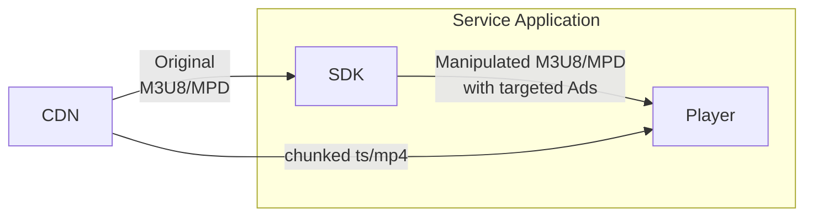
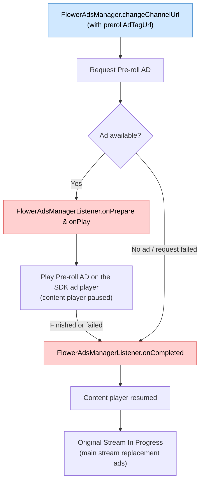
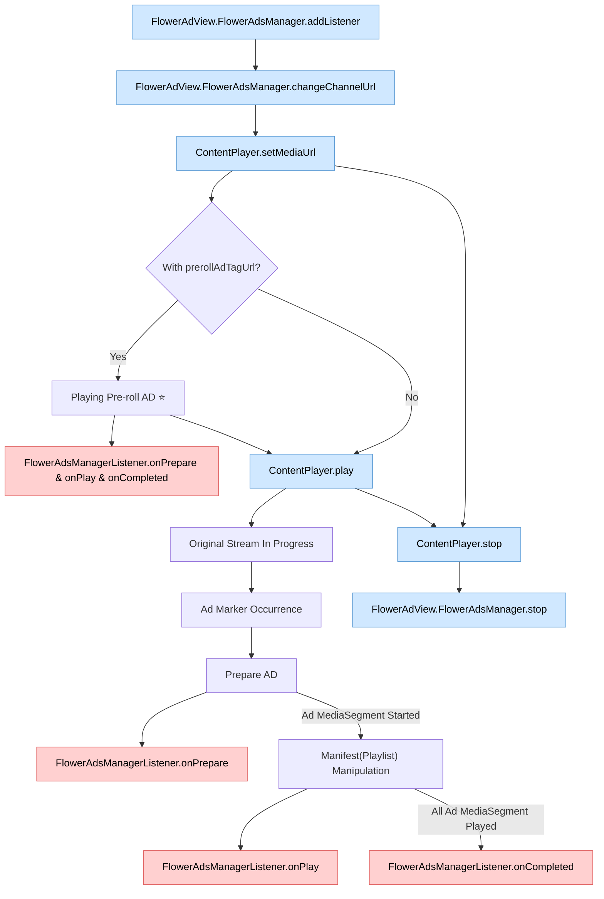

# OTT Linear TV (incl. FAST) Ads

This SDK allows you to play ads when a viewer enters live HLS/DASH content, or insert replacement ads by processing the playlist manifest (m3u8 or mpd) using ad markers.

## Ad Types

### Main Stream Replacement Ads

This ad type replaces the main content stream using ad markers (e.g., SCTE-35). When a replacement ad plays or finishes, the SDK sends events to the host service.

### Channel Entry Ads

These ads play before a viewer enters the main content stream. When a viewer requests to watch live content, they will first see the entry ad. Once the entry ad finishes, the viewer will seamlessly transition to the main content stream.
Note that when using channel entry ads, the app does not need to start playback manually, as the main content stream starts automatically after the entry ad finishes. Starting playback manually may briefly expose the main content video, degrading the UX.

## View Layer Arrangement

The _AdView_ must be the same size as the view in which the main player is placed and overlap that view completely.

_AdView_ is displayed transparently by default, and "Show more" or "Skip" buttons or overlay advertisements can be displayed on it if needed.

## Application Architecture

The player uses the media stream URL provided through the SDK. The SDK manipulates the manifest (m3u8/mpd) or routes segments to replace main content with ads, so no special player-side configuration is needed.

## Pre-roll Ads

A channel pre-roll is the [channel entry ad](#channel-entry-ads) described above. It is enabled by passing `prerollAdTagUrl` to `changeChannelUrl`, and it is independent of the main stream replacement ads: the SDK requests it from its own ad tag and plays it on its own ad player in the _AdView_, not by manipulating the manifest.

- **Flow**: `changeChannelUrl` requests the pre-roll together with the channel and returns the media stream URL as usual. When the pre-roll is ready, the SDK starts it by itself — the app does not call `play` for it — and pauses the content player while it runs. When it ends, the SDK fires `onCompleted` and resumes the content player.
- **No ad or failure**: if the pre-roll tag returns no ad, or the request fails, the SDK fires `onCompleted` and the channel starts as usual. With `changeChannelUrl`, a pre-roll whose playback fails also ends with `onCompleted`, not `onError`. Some player integrations report a playback failure differently; see the Linear TV guide of your platform.
- **When the app starts playback**: when the app calls `changeChannelUrl` itself, it holds the returned URL and sets it on the player at `onCompleted`, so the main content does not flash on screen before the pre-roll. When the SDK's player integration manages the channel (for example an SDK-provided player), the player holds the channel itself. Follow the Linear TV guide of your platform.
- **Channel switch**: every `changeChannelUrl` call stops the current session first, including a pre-roll in progress, and then requests the pre-roll of the new call. Pass the new channel's `prerollAdTagUrl` to play its pre-roll.
- **Restart after `onError`**: a restart leaves the pre-roll out (`prerollAdTagUrl` omitted), because the viewer has already seen it.
- **PIP mode**: by default, a pre-roll pauses when the app enters PIP and resumes when it returns, in the same way as VOD ads. Main stream replacement ads keep playing in PIP.

## Lifecycle

A flowchart showing the entire process of registering an ad event listener and replacing ads while playing the main content.

> **Legend**  
>  &nbsp;Function call made by you
> &nbsp;Event fired by SDK
> ⭐ Optional
