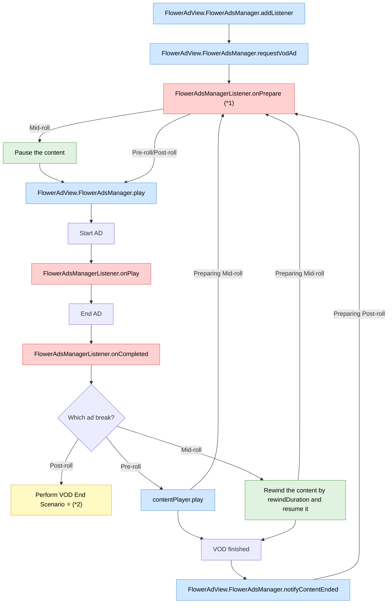

# VOD Ads

This SDK enables you to insert ads during VOD content playback according to your application's ad policy.

## Ad Types

Three types of ads can be inserted into VOD content:

- **Pre-roll ads**: Commercials played before the video content starts.
- **Mid-roll ads**: Commercials played during the video stream.
- **Post-roll ads**: Commercials played at the end of the video stream.

FLOWER manages the ad policies for each type and delivers them to the SDK in VMAP format. Contact your account manager for details.

## View Layer Arrangement

The _AdView_ must be the same size as the view in which the main player is placed and overlap that view completely.

_AdView_ is displayed transparently by default, and "Show more" or "Skip" buttons or overlay advertisements can be displayed on it if needed.

## Lifecycle

A flowchart showing the entire process — from registering an ad event listener to coordinating ad playback with the main content.

> **Legend**  
>  &nbsp;Function call made by you
> &nbsp;Event fired by SDK
> &nbsp;Done by SDK on the content player
> ⭐ Optional

> (\*1) Mid-roll timing and content control
> - The SDK requests a mid-roll ad `requestTimeout + minPrepareDuration` before the mid-roll's position, and calls `onPrepare` when the content reaches that position. Call `play` right away in `onPrepare`.
> - By default (`setIgnoreAdBreakInPIPMode(true)`), ads play in the SDK's own ad player over the content. For a mid-roll, the SDK pauses the content and, after the ad break, resumes it `rewindDuration` (5 seconds by default) before the point where it was interrupted. Do not pause, seek, or reload the content yourself around a VOD ad break.
> - With `setIgnoreAdBreakInPIPMode(false)`, supported players play the ads inside the content player, and the SDK puts the content back at the resume point after the ad break. See the PIP Mode Support page of each platform.

> (\*2) Perform VOD end scenario
> - This SDK provides a way to handle specific scenarios at the end of VOD playback, after any post-roll ads have finished. This allows you to implement custom actions or transitions based on your service's requirements.
> - e.g. Automatically start the next episode in a series.
