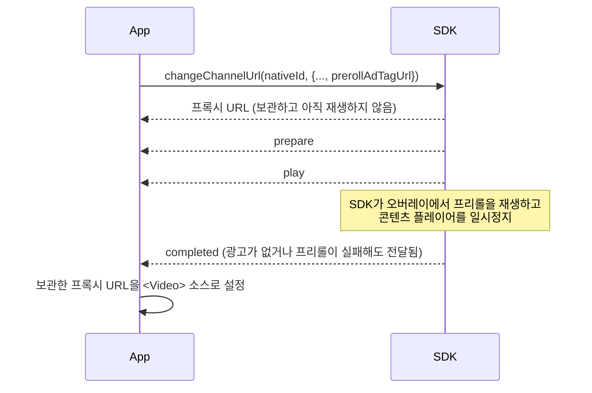

# Linear TV 광고 구현

Linear TV 및 FAST 채널은 `changeChannelUrl()`을 사용합니다. SDK는 원본 스트림에 대체 광고를 매니페스트 단위로 스플라이싱한 로컬 프록시 URL을 반환하며, 광고 브레이크는 스트림의 큐(cue)에 따라 예약되어 자동으로 재생됩니다 — 앱에서 `play()`를 호출할 필요가 없습니다.

먼저 [연동 동작 방식](../how-the-integration-works.md)을 읽어보세요. 아래의 2단계 인계가 그 핵심입니다.

## 구현

```tsx
import React, {useCallback, useEffect, useRef, useState} from 'react';
import {StyleSheet, View} from 'react-native';
import Video from 'react-native-video';
import {
  addAdEventListenerFor,
  changeChannelUrl,
  release,
  stop,
} from '@anypoint/flower-sdk-react-native';

// 매번 실패하는 채널이 끝없이 재시작되지 않도록 하는 간단한 상한입니다.
const MAX_RESTARTS = 3;

type Props = {
  nativeId: string;
  videoUrl: string;
  adTagUrl: string;
  channelId: string;
};

export function ChannelPlayer({nativeId, videoUrl, adTagUrl, channelId}: Props) {
  // 1단계: react-native-video가 플레이어를 만들도록 원본 URL로 마운트합니다.
  const [sourceUri, setSourceUri] = useState(videoUrl);
  const handedOver = useRef(false);
  const restarting = useRef(false);
  const restarts = useRef(0);

  // 2단계: 플레이어를 인계하고, 반환된 프록시 URL을 재생합니다. 최초 시작과
  // 'error' 이후의 모든 재시작에 사용합니다.
  const startChannel = useCallback(async () => {
    const proxyUrl = await changeChannelUrl(nativeId, {
      videoUrl,
      adTagUrl,
      channelId,
    });
    handedOver.current = true;
    // 3단계: 소스를 교체합니다. 플레이어는 재생성되지 않고 재사용됩니다. 호출할 때마다
    // 새 프록시 URL이 반환되므로, 재시작하면 항상 플레이어가 다시 로드됩니다.
    setSourceUri(proxyUrl);
  }, [nativeId, videoUrl, adTagUrl, channelId]);

  // 플레이어가 생성된 뒤의 최초 시작입니다.
  const handOver = useCallback(async () => {
    if (handedOver.current) {
      return;
    }
    try {
      await startChannel();
    } catch (error: any) {
      console.error(`changeChannelUrl failed: ${error.message}`);
    }
  }, [startChannel]);

  // 'error' 시: 광고 매니저를 중지한 뒤, 처음과 똑같이 채널을 다시 시작합니다.
  const restartChannel = useCallback(async () => {
    if (restarting.current || restarts.current >= MAX_RESTARTS) {
      return;
    }
    restarting.current = true;
    restarts.current += 1;
    try {
      await stop(nativeId);
      await startChannel();
    } catch (error: any) {
      console.error(`channel restart failed: ${error.message}`);
    } finally {
      restarting.current = false;
    }
  }, [nativeId, startChannel]);

  // 이 채널의 광고 이벤트만 구독합니다.
  useEffect(() => {
    const subscription = addAdEventListenerFor(nativeId, event => {
      switch (event.event) {
        case 'adBreakPrepare':
          console.log(`ad break loaded: ${event.adCount} ads`);
          break;
        case 'play':
          console.log('ad break started');
          break;
        case 'completed':
          // stop()이 중단시킨 브레이크에 대해서도 도착하므로, 여러 번 와도 문제없게 작성합니다.
          console.log('ad break finished');
          break;
        case 'error':
          console.error(`ad error: ${event.message}`);
          restartChannel();
          break;
      }
    });
    return () => subscription.remove();
  }, [nativeId, restartChannel]);

  // 네이티브 측이 이 채널의 광고 오버레이를 보유하므로, 비디오가 사라질 때 알려야 합니다.
  useEffect(
    () => () => {
      if (handedOver.current) {
        release(nativeId).catch(() => {});
      }
    },
    [nativeId],
  );

  return (
    <View style={styles.player}>
      <Video
        // SDK는 nativeID로 이 플레이어를 찾습니다. 화면 내에서 고유해야 합니다.
        nativeID={nativeId}
        source={{uri: sourceUri}}
        style={StyleSheet.absoluteFill}
        resizeMode="contain"
        // onLoad는 플레이어가 존재한다는 확실한 신호입니다.
        onLoad={handOver}
        onError={e => console.error(`player error: ${JSON.stringify(e)}`)}
      />
    </View>
  );
}

const styles = StyleSheet.create({
  player: {width: '100%', aspectRatio: 16 / 9, backgroundColor: '#000'},
});
```

:::caution
`handOver`를 ref로 가드하는 이유는, 소스를 프록시 URL로 교체하면 `onLoad`가 다시 발생하기 때문입니다. 가드가 없으면 두 번째 `onLoad`에서 `changeChannelUrl()`이 한 번 더 호출됩니다.
:::

## 오류 복구

채널에서 `error` 이벤트가 발생했다는 것은 SDK가 스트림에 광고를 계속 유지할 수 없게 되었다는 뜻입니다 — 예를 들어 플레이리스트 조작에 실패해 플레이어가 깨진 스트림에 머무를 수 있습니다. 스트림 자체가 멈췄고 네이티브 SDK가 이를 복구하지 않을 때도 장애 1건당 한 번 전달되며, 이때 메시지는 `playback unrecoverable`로 시작합니다(iOS의 `playerType: 'bitmovin'`에서는 보고되지 않음). 채널을 처음부터 다시 시작해 복구하세요. 위 예제의 `restartChannel`이 이 작업을 합니다:

1. `await stop(nativeId)`로 채널의 광고 매니저를 중지합니다. `release()`와 달리 광고 오버레이와 이벤트 구독은 그대로 유지되므로, 재시작 시 이를 재사용합니다.
2. `prerollAdTagUrl`을 제외하고 처음과 같은 파라미터로 `changeChannelUrl(nativeId, ...)`을 다시 호출합니다. **새** 프록시 URL이 반환됩니다. 재시작할 때는 채널 프리롤을 넣지 않습니다(`prerollAdTagUrl` 생략). 시청자가 이미 프리롤을 봤기 때문입니다.
3. 그 URL을 `<Video>`의 소스로 설정합니다. 플레이어는 재생성되지 않고 재사용됩니다. `onLoad`가 다시 발생하지만 `handedOver` 가드가 두 번째 인계를 막습니다.

`stop()`은 진행 중인 브레이크도 종료하며, 그 브레이크는 `error` 이후는 물론 `stop()`이 resolve된 뒤에도 `completed`를 보고할 수 있습니다. `completed` 분기는 여러 번 호출되어도 문제없도록(광고 UI 상태 정리만) 작성해 재시작을 방해하지 않게 하세요. `MAX_RESTARTS`는 시작할 때마다 실패하는 채널이 무한히 재시작되지 않도록 하는 간단한 상한입니다. 카운터는 채널 전환 시 등 앱에 맞는 방식으로 초기화하세요.

:::note
[채널 프리롤](#프리롤-광고)에는 이 처리가 필요 없습니다. 실패한 프리롤은 `error`가 아니라 `completed`로 끝납니다. SDK가 프리롤을 마치고 채널을 직접 재개하므로, 아래의 `completed` 처리로 이미 충분합니다. `prerollAdTagUrl`로 처음 시작한 채널이라도 재시작할 때는 채널 프리롤을 넣지 않습니다(`prerollAdTagUrl` 생략). 시청자가 이미 프리롤을 봤기 때문입니다. 따라서 재시작에서는 프록시 URL을 보관하지 않고, 중단된 브레이크가 일찍 보고할 수 있는 `completed`를 기다리지 않고 바로 재생합니다. [프리롤 예제](#프리롤-광고)의 `withPreroll` 플래그가 이를 처리합니다.
:::

## 타게팅과 헤더

`changeChannelUrl()`은 선택적으로 타게팅 정보와 HTTP 헤더를 받습니다:

```tsx
const proxyUrl = await changeChannelUrl(nativeId, {
  videoUrl,
  adTagUrl,
  channelId,
  // 타게팅을 위해 사전 협의된 추가 정보
  extraParams: {title: 'My Summer Vacation', genre: 'horror'},
  // 광고 요청에 추가할 헤더
  adTagHeaders: {'custom-ad-header': 'custom-ad-header-value'},
  // 원본 스트림 요청에 추가할 헤더
  channelStreamHeaders: {'custom-stream-header': 'custom-stream-header-value'},
});
```

타게팅 키는 [extraParams 정의](../define-extra-params.md)를, 전체 파라미터는 [`changeChannelUrl` 레퍼런스](../../api/linear-channels-fast.md)를 참고하세요.

## 프리롤 광고

채널 프리롤은 시청자가 채널에 진입할 때, 실시간 스트림 자체가 표시되기 **전에** 재생되는 광고 브레이크입니다. 스트림에 삽입되는 브레이크와는 별개입니다. SDK가 별도의 광고 태그로 요청하고, 오버레이 안의 SDK 자체 광고 플레이어에서 재생한 뒤에야 채널이 재생되도록 합니다. `changeChannelUrl()`에 `prerollAdTagUrl`을 전달하면 활성화되며, 전달하지 않으면 프리롤 없이 채널이 시작됩니다.

### 동작 방식



1. `changeChannelUrl()`은 채널과 함께 프리롤을 요청하고, 평소처럼 프록시 URL로 resolve됩니다. 그 URL을 소스로 설정하지 말고 **보관**하세요.
2. SDK가 프리롤을 직접 시작합니다. `prepare`와 `play`를 보내고, 프리롤이 화면에 표시되는 동안 콘텐츠 플레이어를 일시정지합니다. 앱은 프리롤을 위해 아무것도 호출하지 않습니다 — `play()`도 호출하지 않습니다.
3. 프리롤이 끝나면 SDK가 `completed`를 보냅니다. 이때 보관한 프록시 URL을 `<Video>`의 소스로 설정하세요. 그 이후 채널은 프리롤이 없을 때와 똑같이 동작합니다.

그때까지 `<Video>`는 원본 URL에서 일시정지 상태로 두세요([Linear TV 프롬프트](../../prompts/by-case/linear-tv/react-native-video.md)처럼 프리롤을 기다리는 동안 `paused` 설정). 그래야 프리롤 전이나 프리롤 아래에서 채널 영상이나 소리가 노출되지 않습니다. 일시정지 상태에서도 `onLoad`는 발생하므로 인계에는 영향이 없습니다.

**광고가 없거나 실패한 경우.** 프리롤 태그가 광고를 반환하지 않거나 프리롤 요청 또는 재생이 실패해도, SDK는 `error`가 아니라 `completed`로 마무리합니다. 따라서 보관한 프록시 URL이 적용되고 채널이 시작됩니다. 실패한 프리롤은 재시작할 필요가 없습니다.

아래 예제는 프록시 URL을 보관했다가 `completed`에서 적용합니다:

```tsx
const [sourceUri, setSourceUri] = useState(videoUrl);
const proxyUrlRef = useRef<string | null>(null);

useEffect(() => {
  const subscription = addAdEventListenerFor(nativeId, event => {
    if (event.event === 'completed' && proxyUrlRef.current) {
      // 프리롤이 끝났으므로 이제 콘텐츠를 프록시 URL로 전환합니다.
      setSourceUri(proxyUrlRef.current);
      proxyUrlRef.current = null;
    }
  });
  return () => subscription.remove();
}, [nativeId]);

// withPreroll: 첫 시작(handOver)에서는 true, 'error' 후 재시작에서는 false입니다.
const startChannel = useCallback(
  async (withPreroll: boolean) => {
    // 재시작할 때는 채널 프리롤을 넣지 않습니다(prerollAdTagUrl 생략). 시청자가 이미 프리롤을 봤기 때문입니다.
    const preroll = withPreroll ? prerollAdTagUrl : undefined;
    const proxyUrl = await changeChannelUrl(nativeId, {
      videoUrl,
      adTagUrl,
      channelId,
      prerollAdTagUrl: preroll,
    });
    if (preroll) {
      // 즉시 적용하지 않고 보관합니다 — 프리롤이 먼저 재생됩니다.
      proxyUrlRef.current = proxyUrl;
    } else {
      // 재시작에는 프리롤이 없으므로 기다릴 것이 없습니다. 새 프록시 URL을 바로 재생합니다.
      proxyUrlRef.current = null;
      setSourceUri(proxyUrl);
    }
  },
  [nativeId, videoUrl, adTagUrl, channelId, prerollAdTagUrl],
);
```

첫 시작에서는 `startChannel(true)`를 호출하고, `restartChannel`은 `stop()` 후 `startChannel(false)`를 호출합니다. 재시작 상한은 [위 예제](#구현)와 같이 유지합니다.

### 채널 전환

`changeChannelUrl()`을 호출할 때마다 새 세션이 시작됩니다. SDK는 먼저 현재 세션을 중지하고 — 아직 재생 중인 프리롤도 포함됩니다 — 새 호출에 담긴 채널의 프리롤을 요청합니다. 따라서 자체 `prerollAdTagUrl`이 있는 다른 채널로 전환하는 것은 다시 첫 시작과 같습니다. 새 프록시 URL을 `completed`까지 보관하세요. 프리롤 없이 전환하려면 `prerollAdTagUrl`을 생략하고 새 프록시 URL을 바로 재생하세요. 의도적으로 프리롤을 넣지 않는 호출은 `error` 이후의 재시작뿐입니다 — [오류 복구](#오류-복구)를 참고하세요.

### PIP 모드

기본 모드(`setIgnoreAdBreakInPIPMode(true)`)에서 채널 프리롤은 앱이 PIP에 진입하면 일시정지되고 앱으로 돌아오면 재개됩니다. VOD 광고와 같은 방식이며, 스트림에 삽입된 광고는 계속 재생됩니다. 앱이 두 시점을 모두 `notifyPictureInPictureModeChanged()`로 알려야만 동작합니다. [PIP 모드 지원](../../getting-started/pip-mode-support.md)을 참고하세요.

### Bitmovin 플레이어

`playerType: 'bitmovin'`에서도 프리롤은 같은 방식으로 동작합니다. 프록시 URL을 보관했다가 `completed`에서 Bitmovin 플레이어에 로드하세요. [Bitmovin 플레이어 사용하기](../using-bitmovin-player.md#채널-프리롤)를 참고하세요.

## 광고 브레이크 중단

`stop(nativeId)`은 채널의 광고 매니저를 중지합니다. 진행 중인 광고 브레이크뿐 아니라 광고 세션도 종료됩니다. SDK가 광고 처리를 정리하고 로컬 프록시를 종료하므로, `<Video>`가 재생 중인 프록시 URL은 더 이상 응답하지 않고 이후의 브레이크도 재생되지 않습니다. 광고 오버레이와 이벤트 구독은 그대로 유지됩니다. 광고와 함께 채널을 계속 시청하려면 `changeChannelUrl()`을 다시 호출하고 새로 반환된 프록시 URL을 재생하세요.

```tsx
await stop(nativeId);
```

채널에서 완전히 벗어날 때는 `release(nativeId)`를 호출하세요. `error` 이후의 `stop()`은 재시작의 첫 단계입니다 — [오류 복구](#오류-복구)를 참고하세요.

## 관련 문서

*   [`changeChannelUrl` API 레퍼런스](../../api/linear-channels-fast.md)
*   [광고 이벤트](../../api/ad-event.md)
*   [Bitmovin 플레이어 사용하기](../using-bitmovin-player.md)
