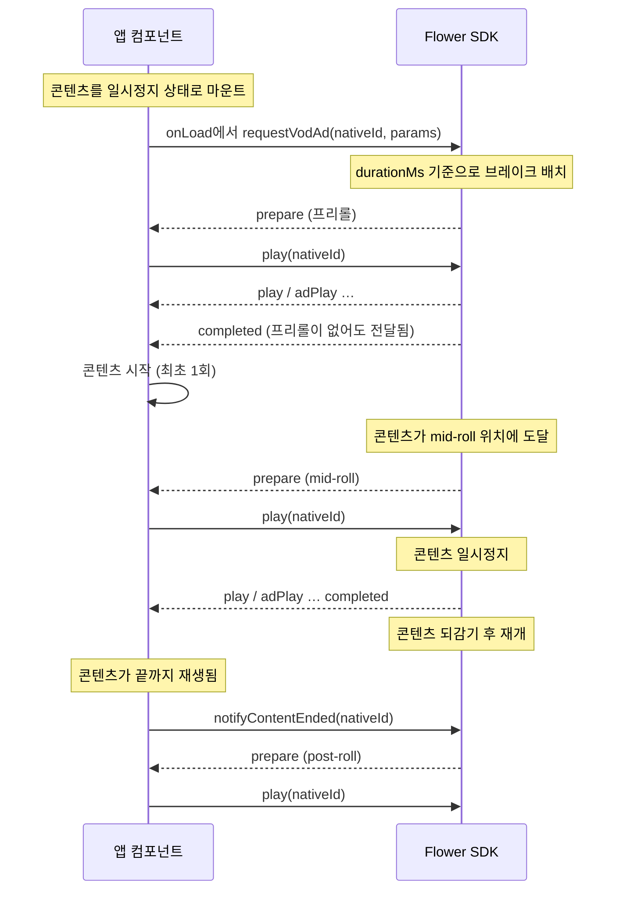

# VOD 광고 구현

VOD 광고는 `requestVodAd()`로 요청합니다. 여기서는 아무것도 재작성되지 않습니다 — 콘텐츠는 원래 URL로 계속 재생되고, 각 광고 브레이크는 `prepare` 이벤트로 전달되며, 앱은 이때 `play()`를 호출합니다.

콘텐츠와 관련해 앱이 할 일은 정확히 두 가지입니다. **처음 시작하기 전에는 붙잡아 두고**, **그 이후에는 건드리지 않는 것**입니다 — 브레이크가 실패했을 때도 마찬가지입니다.

*   **처음 시작하기 전.** SDK는 프리롤을 위해 콘텐츠를 일시정지하지 않습니다. `<Video>`를 일시정지 상태로 마운트하고, `onLoad`에서 광고를 요청한 뒤, 첫 `completed` 또는 `error`에서 콘텐츠를 시작하세요. 프리롤이 없거나, 광고 응답이 비어 있거나, 요청이 실패해도 SDK는 `completed`를 보내므로 콘텐츠는 항상 시작됩니다.
*   **콘텐츠가 시작된 이후.** 기본 설정([`setIgnoreAdBreakInPIPMode`](../../getting-started/pip-mode-support.md) `true`)에서 브레이크는 `<Video>` 위에 겹쳐진 SDK 자체 광고 플레이어에서 재생됩니다. mid-roll의 경우 SDK가 직접 콘텐츠를 일시정지하고, `completed`(또는 `error`) 시점에 되감기 시간(5초)만큼 되돌려 재개합니다. post-roll 이후에는 콘텐츠가 이미 끝났으므로 재개하지 않습니다. **콘텐츠가 시작된 뒤에는 일시정지, 탐색, 재로드하지 마세요.**
*   **콘텐츠가 시작된 이후의 `error`.** 로그만 남기세요. 브레이크가 실패하면 SDK가 `error`를 보내기 전에 콘텐츠를 되돌려 놓으므로, mid-roll이 실패했을 때 콘텐츠는 이미 다시 재생 중입니다: 재개도, 탐색도, 소스 변경도 하지 마세요. 콘텐츠가 끝났다면(post-roll 실패) 역시 할 일이 없습니다. 예외는 메시지가 `playback unrecoverable`로 시작하는 `error`로, 콘텐츠 자체가 멈춘 경우입니다. [`error` 처리](#handling-error)를 참고하세요.

## 광고 브레이크 생명주기



## 구현

```tsx
import React, {useCallback, useEffect, useRef, useState} from 'react';
import {StyleSheet, View} from 'react-native';
import Video, {type VideoRef} from 'react-native-video';
import {
  addAdEventListenerFor,
  notifyContentEnded,
  play,
  release,
  requestVodAd,
} from '@anypoint/flower-sdk-react-native';

type Props = {
  nativeId: string;
  contentUrl: string;
  adTagUrl: string;
  contentId: string;
  durationMs: number;
};

export function VodPlayer({
  nativeId,
  contentUrl,
  adTagUrl,
  contentId,
  durationMs,
}: Props) {
  // 프리롤이 끝날 때까지 콘텐츠를 붙잡아 둡니다. false에서 true로만 바뀝니다.
  const [contentStarted, setContentStarted] = useState(false);
  // 같은 두 사실을, 재구독 없이 이벤트 리스너에서 읽을 수 있도록 ref로 둡니다.
  const contentStartedRef = useRef(false);
  const contentEnded = useRef(false);
  const videoRef = useRef<VideoRef>(null);
  const requested = useRef(false);

  useEffect(() => {
    const startContent = () => {
      contentStartedRef.current = true;
      setContentStarted(true);
    };
    const subscription = addAdEventListenerFor(nativeId, event => {
      if (event.event === 'prepare') {
        // 브레이크 재생만 합니다. 콘텐츠가 시작된 뒤의 일시정지/재개는 SDK가 처리합니다.
        play(nativeId).catch(e => console.error(`play failed: ${e.message}`));
      } else if (event.event === 'completed') {
        // 첫 completed는 프리롤의 종료이거나, 프리롤이 없을 때 그 자리를 대신합니다.
        // 이후의 completed는 아무것도 바꾸지 않습니다. 콘텐츠는 이미 시작되었습니다.
        startContent();
      } else if (event.event === 'error') {
        console.error(`ad error: ${event.message}`);
        if (!contentStartedRef.current) {
          // 프리롤 실패: 콘텐츠를 붙잡힌 채로 두지 않습니다.
          // 같은 브레이크에 completed도 올 수 있으며, startContent()는 두 번 호출되어도 안전합니다.
          startContent();
        } else if (event.message?.startsWith('playback unrecoverable')) {
          // 콘텐츠 자체가 멈췄고 SDK가 복구하지 않습니다:
          // 콘텐츠를 다시 로드하거나 오류를 표시하세요.
        }
        // mid-roll 실패: SDK가 이미 콘텐츠를 재개했습니다. 재개, 탐색, 소스 변경 없음.
        // post-roll 실패: 콘텐츠가 끝났으므로 재개할 것이 없습니다.
      }
    });
    return () => subscription.remove();
  }, [nativeId]);

  useEffect(
    () => () => {
      if (requested.current) {
        release(nativeId).catch(() => {});
      }
    },
    [nativeId],
  );

  // 요청 전에 플레이어가 존재해야 하므로 onLoad에서 호출합니다.
  const request = useCallback(async () => {
    if (requested.current) {
      return;
    }
    try {
      await requestVodAd(nativeId, {adTagUrl, contentId, durationMs});
      requested.current = true;
    } catch (error: any) {
      console.error(`requestVodAd failed: ${error.message}`);
    }
  }, [nativeId, adTagUrl, contentId, durationMs]);

  return (
    <View style={styles.player}>
      <Video
        ref={videoRef}
        nativeID={nativeId}
        // VOD에서는 콘텐츠 URL이 재작성되지 않습니다.
        source={{uri: contentUrl}}
        style={StyleSheet.absoluteFill}
        resizeMode="contain"
        // 처음 시작하기 전에만 붙잡아 둡니다. 광고 이벤트로 다시 일시정지하지 않습니다.
        paused={!contentStarted}
        onLoad={request}
        // 이 호출이 없으면 SDK는 콘텐츠 종료를 알 수 없고 post-roll도 재생되지 않습니다.
        onEnd={() => {
          // 먼저 표시해 두어, post-roll 오류가 끝난 콘텐츠를 재개하지 않게 합니다.
          contentEnded.current = true;
          notifyContentEnded(nativeId).catch(e =>
            console.error(`notifyContentEnded failed: ${e.message}`),
          );
        }}
        onError={e => console.error(`player error: ${JSON.stringify(e)}`)}
      />
    </View>
  );
}

const styles = StyleSheet.create({
  player: {width: '100%', aspectRatio: 16 / 9, backgroundColor: '#000'},
});
```

:::caution
`requestVodAd()`는 `changeChannelUrl()`과 마찬가지로 플레이어가 먼저 존재해야 합니다. 마운트 시점이 아니라 `onLoad` 이후에 호출하세요. Linear TV와 달리 이후 소스 교체가 없어 `onLoad`가 한 번만 발생하므로 재진입 가드가 반드시 필요하지는 않지만, 위 예제의 ref는 컴포넌트 재마운트 상황에서 안전을 확보해 줍니다.
:::

:::caution 콘텐츠는 시작 전에만 붙잡아 두고, 시작 후에는 건드리지 마세요
SDK는 프리롤을 위해 콘텐츠를 붙잡아 두지 않습니다. `paused` 없이 마운트하면 프리롤 아래에서 콘텐츠가 함께 재생되어 두 소리가 동시에 들립니다. 위 예제처럼 첫 `completed` 또는 `error`까지 콘텐츠를 붙잡아 두세요.

콘텐츠가 시작된 뒤에는 `prepare`, `play`, `completed`, `error`에서 `paused` prop(또는 Bitmovin 플레이어의 `pause()`, `seek()`, `load()`)을 조작하지 마세요. 이 시점들은 SDK가 담당합니다. mid-roll을 위해 콘텐츠를 일시정지하고, `completed` 시점에 되감은 뒤 재개합니다. iOS의 `playerType: 'bitmovin'`도 마찬가지로, SDK가 Bitmovin 플레이어를 통해 콘텐츠를 일시정지하고 재개합니다. 브레이크가 실패했을 때도 앱이 할 일은 없습니다 — [아래](#handling-error)를 참고하세요.

`setIgnoreAdBreakInPIPMode(false)`인 경우 브레이크는 SDK가 `<Video nativeID={nativeId}>`에서 인계받은 player에서 재생됩니다. 콘텐츠가 시작된 뒤 `play()` 전후로 일시정지를 걸면 광고가 재생 중인 player에 적용되어 광고가 멈추고, `completed`가 전달되지 않으며, 콘텐츠도 돌아오지 않습니다. 이 모드에 대해서는 [PIP 모드 지원](../../getting-started/pip-mode-support.md)을 참고하세요.
:::

## `error` 처리 {#handling-error}

VOD에서 `error`는 다음 경우에 전달됩니다:

*   **광고 재생 실패** — 프리롤, mid-roll, post-roll의 광고 미디어를 디코딩할 수 없거나 접근할 수 없는 경우.
*   **콘텐츠가 멈췄고 SDK가 이를 복구하지 않는 경우.** 메시지는 `playback unrecoverable`로 시작합니다. 네이티브 플레이어 어댑터가 장애 1건당 한 번 보내며, 재생이 다시 진행되면 이후의 중단은 새 장애로 취급됩니다. iOS의 `playerType: 'bitmovin'`에서는 앱 측 Bitmovin 어댑터가 이를 보고하지 않습니다.
*   **Android에서 SDK의 로컬 프록시 서버가 응답하지 못한 경우.** VOD 광고 미디어는 이 서버를 거쳐 캐시됩니다.

VMAP/VAST 요청이 실패하거나 타임아웃되는 경우, 또는 광고가 없는 브레이크는 `error`가 아닙니다. 이때는 `completed`로 끝납니다(광고가 없으면 reason `1`의 `adBreakSkipped`가 먼저 옵니다).

브레이크가 광고 오류로 실패하면 SDK는 먼저 광고를 중지하고 콘텐츠를 직접 되돌려 놓은 뒤, 그다음에 `error`를 보냅니다. 기본 설정에서는 mid-roll을 위해 일시정지했던 콘텐츠를 브레이크가 중단시킨 지점보다 되감기 시간만큼 앞에서 재개합니다. `setIgnoreAdBreakInPIPMode(false)`에서는 광고 플레이어가 실패한 광고를 버리고, `<Video>`에서 인계받은 player에 같은 위치로 콘텐츠를 되돌려 놓아 재생합니다. 따라서 `error` 시 앱이 할 일은 콘텐츠의 상태에 따라서만 달라집니다:

| 콘텐츠 | 실패한 대상 | 앱이 할 일 |
| ---| ---| --- |
| 아직 시작 전 | 프리롤 | `completed`와 마찬가지로 붙잡아 둔 콘텐츠를 시작 |
| 시작했고 끝나지 않음 | Mid-roll | 없음 — 콘텐츠는 이미 다시 재생 중입니다. 재개, 탐색, 소스 변경 없음. |
| 종료됨(`onEnd` 발생) | Post-roll | 없음 — 재생이 끝났습니다 |
| 멈춤 | 콘텐츠 자체(`playback unrecoverable`) | 콘텐츠를 다시 로드하거나 오류를 표시 |

위 예제처럼 `notifyContentEnded()`를 호출하기 전에 `onEnd`에서 설정하는 ref로 종료 여부를 추적하세요.

실패한 브레이크는 `completed`도 보낼 수 있으며, `error`보다 먼저 올 수도 나중에 올 수도 있습니다. 위의 `startContent()`처럼 두 분기 모두 같은 브레이크에 대해 실행되어도 안전하게 두세요. `setIgnoreAdBreakInPIPMode(false)`에서는 광고 플레이어와 콘텐츠 플레이어 어댑터가 player를 함께 사용하므로, 광고 실패 1건이 `error` 이벤트 두 번으로 나타날 수 있습니다.

:::note iOS의 알려진 이슈
여러 광고로 구성된 브레이크 안에서 광고의 미디어 URL에 접근할 수 없는 경우, 현재 iOS 광고 플레이어가 이를 오류로 보고하지 않아 브레이크가 멈춥니다. 수정이 진행 중입니다.
:::

## 프리롤, Mid-roll, Post-roll

브레이크 위치는 광고 응답에서 결정되며, 전달한 `durationMs`를 기준으로 배치됩니다. 따라서 이 값은 콘텐츠의 실제 총 재생 시간(밀리초)이어야 합니다.

| 브레이크 | 발생 시점 |
| ---| --- |
| 프리롤 | `requestVodAd()` 완료 직후, 앱이 아직 콘텐츠를 붙잡아 두고 있을 때의 `prepare` 이벤트 |
| Mid-roll | 재생 위치가 브레이크 지점에 도달했을 때의 `prepare` 이벤트 (광고 요청은 약 10초 먼저 이루어짐) |
| Post-roll | `notifyContentEnded()` 호출 이후의 `prepare` 이벤트 |

광고 응답에 프리롤이 없거나, 브레이크가 전혀 없거나, 요청이 실패하면 콘텐츠 시작 전에 `prepare`가 오지 않습니다. 대신 SDK가 `completed`를 보내며, 이것이 붙잡아 둔 콘텐츠를 시작하는 신호가 됩니다.

:::caution
앱이 `notifyContentEnded(nativeId)`를 호출하지 않으면 post-roll이 재생될 수 없습니다. `<Video>` 컴포넌트의 `onEnd` prop에 연결하세요. `setIgnoreAdBreakInPIPMode(false)`인 경우 브레이크 이후 `onEnd`를 신뢰할 수 없습니다 — [PIP 모드 지원](../../getting-started/pip-mode-support.md#플레이어-이벤트-처리)을 참고하세요.
:::

## 타게팅과 헤더

```tsx
await requestVodAd(nativeId, {
  adTagUrl,
  contentId,
  durationMs,
  extraParams: {title: 'My Summer Vacation', genre: 'horror'},
  adTagHeaders: {'custom-ad-header': 'custom-ad-header-value'},
});
```

[extraParams 정의](../define-extra-params.md)와 [`requestVodAd` API 레퍼런스](../../api/vod.md)를 참고하세요.

## 관련 문서

*   [`requestVodAd` API 레퍼런스](../../api/vod.md)
*   [광고 이벤트](../../api/ad-event.md)
*   [연동 동작 방식](../how-the-integration-works.md)
